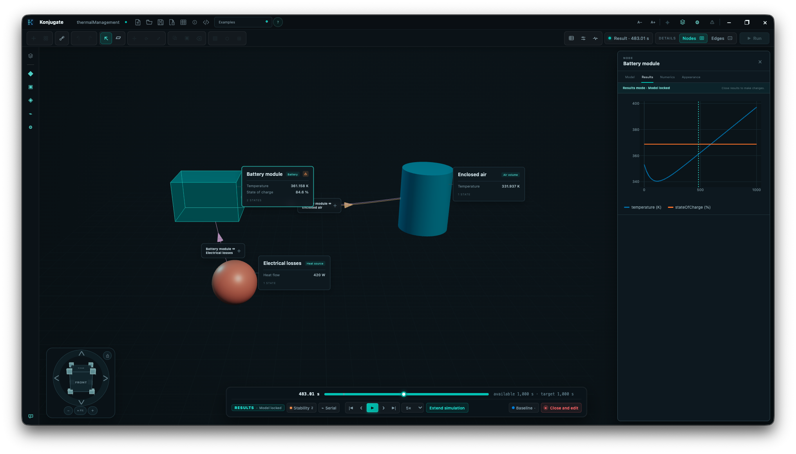
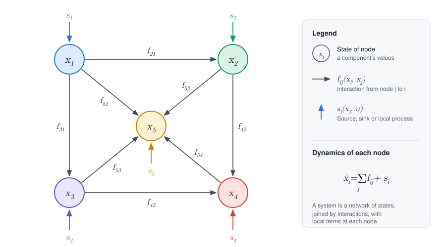
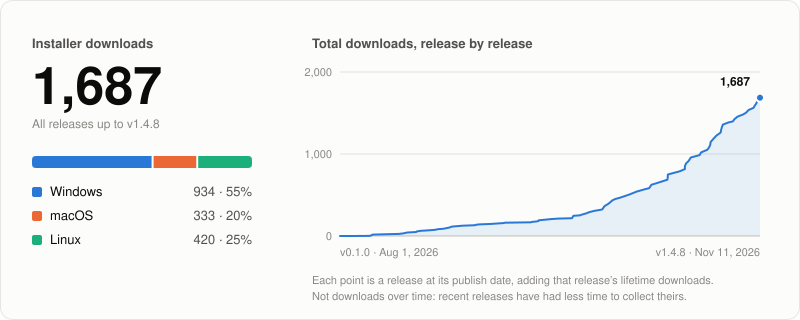

<!-- Copyright © 2026 Zenin Easa Panthakkalakath -->

# Konjugate

**An open-source, graph-native simulation engine for composable engineering simulations and digital twins.**

Draw a system as components connected by relationships, write each one's equations, and run it. Konjugate assembles the whole system for you, and the same model can be steered live, fitted to measured data, kept in step with a real system as a digital twin, or exported as code.

<p align="center">
<a href="https://github.com/zenineasa/Konjugate/releases/latest"></a>
<a href="https://web.konjugate.com/"></a>
<a href="https://discord.gg/WPUzNyC3S"></a>
<a href="https://whatsapp.com/channel/0029Vb8dF8EKgsNs7dydEG1x"></a>
</p>

<p align="center"></p>

## What you can do with it

- **Model a system as a graph.** Nodes hold states, edges carry the equations between them, written in ordinary LaTeX. Group repeated structure into subsystems and edge groups, and reuse it.
- **Run it and steer it.** Watch a run as it happens, change a parameter mid-run, fork a scenario from any point, and replay the result. Larger models are partitioned and run in parallel.
- **Build digital twins.** Connect a running model to live measurements from a data log, an MQTT broker, an OPC UA server or a script, keep it in step with the real system, refit it as it drifts, and forecast ahead. See [Connecting a data source](docs/connectingADataSource.md).
- **Start from data.** Import a CSV of time series and Konjugate proposes which variables drive which, in what direction and with what equation, for you to review before anything is added. See [Causal inference](docs/causalInference.md).
- **Describe it in words.** The Model Assistant turns a plain-language request into model changes you can review and undo, with local or hosted models. See [the Model Assistant guide](docs/aiAssistantGuide.md).
- **Take it elsewhere.** Export standalone C++ or an FMI 2.0/3.0 FMU, import FMUs, or run projects headlessly from the command line. See [Code export](docs/codeExport.md).

<p align="center">
<a href="https://www.youtube.com/watch?v=jiL0kP0VQvQ"></a>
<br>
New here? Watch the introduction, then follow the <a href="https://www.youtube.com/watch?v=eDHksSqKhFs&list=PLRaxEsOU31bE">On-Ramp series</a> from Episode 1.
</p>

## Get Konjugate

Konjugate runs on macOS, Windows and Linux. It is in public beta: used for real work, but the engine, file schema and interface still change between releases. To look around first, **[try it in your browser](https://web.konjugate.com/)** with nothing to install; the browser edition runs models in batch and leaves out C++ providers, FMUs, add-ons and the Model Assistant.

Konjugate is not code-signed yet, so a download from the releases page may bring up a security warning the first time you open it. The download is not damaged; each section below says what to do.

### macOS

Install with [Homebrew](https://brew.sh), which checks the download against its published checksum and opens without a warning:

```bash
brew install --cask zenineasa/konjugate/konjugate
```

Or download the DMG for Apple silicon or Intel from the [latest release](https://github.com/zenineasa/Konjugate/releases/latest). If macOS then says "Konjugate.app is damaged and can't be opened", move it to Applications and run `xattr -cr /Applications/Konjugate.app` in Terminal, or open System Settings → Privacy & Security → Open Anyway.

### Windows

Install from the [Microsoft Store](https://apps.microsoft.com/detail/9p5c9s7dsrpj), which is signed by Microsoft, shows no warning and keeps Konjugate up to date.

Or download the installer from the [latest release](https://github.com/zenineasa/Konjugate/releases/latest). If SmartScreen then shows "Windows protected your PC", click **More info**, then **Run anyway**.

### Linux

On **Debian 12, Ubuntu 22.04 or newer**, add Konjugate's apt repository, then install and update it like any other package:

```bash
repo=https://github.com/zenineasa/Konjugate/releases/latest/download
key=/etc/apt/keyrings/konjugate.gpg

# Add the Konjugate archive signing key
sudo install -d -m 0755 /etc/apt/keyrings
sudo wget -nv -O "$key" "$repo/konjugate-archive-keyring.gpg"

# Add the Konjugate APT repository
sudo tee /etc/apt/sources.list.d/konjugate.sources > /dev/null <<EOF
Types: deb
URIs: $repo/
Suites: ./
Signed-By: $key
EOF

# Install Konjugate
sudo apt update
sudo apt install konjugate
```

On **any distribution from 2022 or newer** (glibc 2.35, as in Ubuntu 22.04, Debian 12 or Fedora 36), run the AppImage, with nothing to install:

```bash
release=https://api.github.com/repos/zenineasa/Konjugate/releases/latest

# Download the AppImage for this machine (x86_64 or aarch64)
url=$(wget -qO- $release | grep -o "https://[^\"]*-$(uname -m)\.AppImage\"" | tr -d '"')
wget "$url"

# Make it executable and run it
chmod +x Konjugate-*.AppImage
./Konjugate-*.AppImage
```

Or download the AppImage for your machine from the [latest release](https://github.com/zenineasa/Konjugate/releases/latest) yourself, then run the last two commands.

## How it works

A dynamic system is usually written as one large function, $\dot{x} = f(x, u, t)$, of every state $x$, input $u$ and time $t$. As a system grows, $f$ becomes a tangle of coupled terms that is hard to read, change or extend.

Konjugate builds $f$ from small pieces instead. Each node $i$ holds some states $x_i$, and its rate of change is the sum of what its relationships bring in plus what happens locally:

```math
\dot{x}_i = \sum_j f_{ij}(x_i, x_j, t) + s_i(x_i, u, t)
```

where $f_{ij}$ is the interaction from node $j$ to node $i$, such as convective heat transfer from a battery to the air around it, and $s_i$ is a source, sink or local process, such as electrical heating or an applied input.

<p align="center">
<picture>
	<source media="(prefers-color-scheme: dark)" srcset="assets/ForReadme/graphRepresentation-dark.svg">
	
</picture>
</p>

Any term can depend on time and be piecewise, so a heater that only runs during working hours is written directly in its equation:

```math
s_i = \begin{cases} P & 28800 \le t < 64800 \\ 0 & \text{otherwise} \end{cases}
```

which heats with power $P$ from 08:00 to 18:00 on the first day ($t$ in seconds). Because every piece is local, a model is assembled from reusable components rather than rewritten as a whole, and the same project runs unchanged in the app, in the browser, from the command line or as exported code.

## Build on Konjugate

Konjugate is meant to be extended. Each of these has its own guide:

- **Add-ons** (`.kja`) open their own windows on a project and its results: visualizers, dashboards, tools. Start with [Add-on development](docs/addonDevelopment.md) and the [Hello World add-on](docs/helloWorldAddon.md).
- **Plugins** (`.kjp`) add relationship providers written in C++ or Python and reusable component templates. See [Plugin development](docs/pluginDevelopment.md).
- **Publishing:** add-ons and plugins are found and installed from Konjugate's own Extensions Explorer, from registries anyone can host, with no central marketplace. See [the Extensions Explorer](docs/extensionsExplorer.md) and [Package registry](docs/registry.md).
- **Scripting and automation:** run or validate a project headlessly with `konjugate --cli` ([Command-line use](docs/engineCli.md#getting-a-portable-result-konjugate---cli)), feed a running twin readings from your own program ([Connecting a data source](docs/connectingADataSource.md)), or read and write projects directly ([Project schema](docs/projectSchema.md), [KJT format](docs/kjtFormat.md)).

Published extensions you can install today:

| Extension | What it does |
| --- | --- |
| [Logistics Toolbox](https://github.com/zenineasa/Konjugate-Logistics) | Ports, warehouses, and road and rail lanes conserving containers and trucks as stocks and flows, plus a tool that turns any region's OpenStreetMap data into a runnable network model. |
| [Fintech Toolbox](https://github.com/zenineasa/Konjugate-Fintech) | Quantitative finance and systemic risk: interbank contagion stress tests and market-dynamics causal transmission. |
| [Robotics Toolbox](https://github.com/zenineasa/konjugate-robotics) | Draw a robot from solids and joints in 3D and build it into the canvas, each solid a node and each joint an edge with its own equations. |
| [Pose Visualizer](https://github.com/zenineasa/Konjugate-PoseVisualizer) | A Three.js 6-DOF pose visualizer for results, with timeline-synced playback. |
| [Results Analysis](https://github.com/zenineasa/Konjugate-ResultPlotViewer) | Time-series, scatter and distribution plots for exploring and comparing results, with CSV export. |
| [Hello World](https://github.com/zenineasa/Konjugate-HelloWorld) | The smallest possible add-on, as a starting point for writing your own. |

## Build from source

You need Node.js 24.19 or newer, CMake 3.20 or newer, Git and a C++20 toolchain (Xcode Command Line Tools on macOS, Visual Studio 2022 with **Desktop development with C++** on Windows, `build-essential` on Debian and Ubuntu). Then:

```bash
npm ci
npm run setup   # native dependencies, engine config
npm run dev     # build the engine, start the app
```

`make` builds an installer for your platform into `out/release/`, and `npm test` runs the unit tests. [Development setup](docs/developmentSetup.md) covers each platform in detail, the test suites, the browser edition's toolchain and release builds, and [the documentation index](docs/index.md) lists the rest.

## Community and contributing

Questions, ideas and models are welcome on [Discord](https://discord.gg/WPUzNyC3S) and the [WhatsApp channel](https://whatsapp.com/channel/0029Vb8dF8EKgsNs7dydEG1x). To contribute code, read [CONTRIBUTING.md](CONTRIBUTING.md): pull requests ask you to sign a short copyright assignment agreement in the pull request itself.

<p align="center">
<picture>
	<source media="(prefers-color-scheme: dark)" srcset="assets/ForReadme/downloads-dark.svg">
	
</picture>
</p>

## License

Konjugate is licensed under the [Mozilla Public License 2.0](LICENSE). The bundled example projects in `examples/` and their guides are released under the [Zero-Clause BSD license](examples/LICENSE), so you may use, change and share them for any purpose.

Copyright © 2026 Zenin Easa Panthakkalakath
