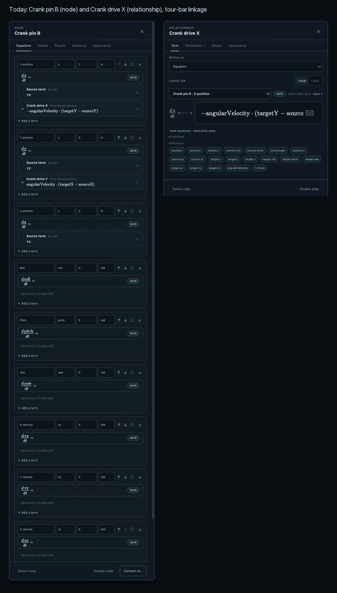
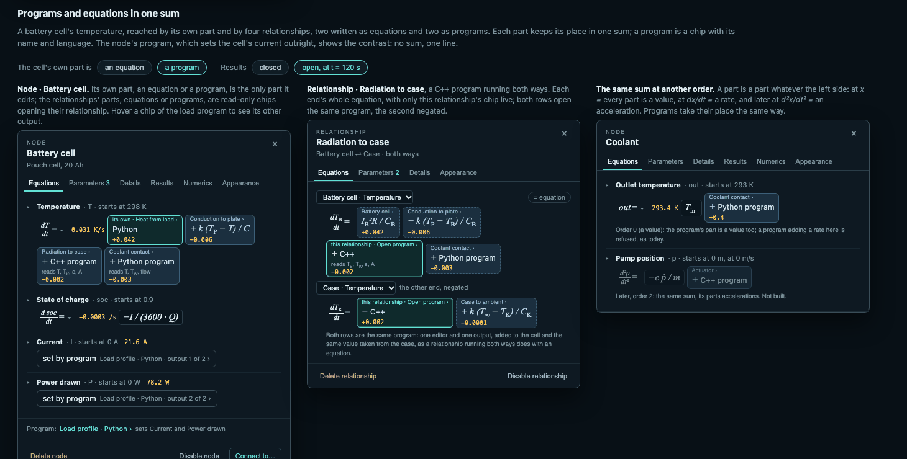

<!-- Copyright © 2026 Zenin Easa Panthakkalakath -->

# One editor for nodes and relationships, with one equation per state

**Status: accepted 21 November 2026, being built in stages A to H (below). It follows [Rates and updates](ratesAndUpdates.md), whose step 5 left "one editor written once for both kinds of term" still to come, and replaces this proposal's first version, which kept a node's Equations tab as it is and only aligned the cards around it.**

## Decisions

The review accepted the recommendation on each question this proposal asked, with one change (10):

| # | Question | Decision |
| --- | --- | --- |
| 1 | Short names | Derived from the node's name, and editable on Details. |
| 2 | Several own terms on one state | Shown as one sum; the first edit merges them into one term, their parameters merged too. |
| 3 | Own programs per state | A node's own program only through its program section, not per state. A file that has a per-state program keeps it, shown as a chip opening its code; none is made anew. |
| 4 | The builders | Retired: New relationship picks two ends and opens its card on a new, empty part; New node opens its card with one state. One undo removes either. |
| 5 | Results for a relationship | Each relationship's part is recorded over a run, giving relationships a Results tab. |
| 6 | Display symbols | A parameter may have a display symbol (ω for angularVelocity), stored beside the symbol the engine reads. |
| 7 | The group's name | Relationship group. |
| 8 | The order from a relationship | Changed only on its node; a relationship's card shows the left side, not as a control. |
| 9 | Folding | Only states nothing changes. |
| 10 | Storing the order | `kind` stays for orders 0 and 1; `order` is added only above 1, so a file using neither stays readable by older Konjugate. |
| 11 | Values during results | Each part's value is recorded in a run, and chips show it while results are open. |
| 12 | Outputs of one program | "output 1 of 2", in words. |
| 13 | Relationship programs writing several states | Deferred. |
| 14 | Linked components and kinds | Deferred. |

**Compatibility is a requirement, not a goal:** every `.kjt` and result a released version wrote opens, every bundled example and test model gives the same numbers to the bit, a file this version writes stays readable by older versions wherever a new feature is not used (a new field is written only when it is not its default, and the codec keeps passing through fields it does not know), and results from older versions open. The [Saved format](#saved-format) section lists every change, and [Compatibility tests](#compatibility-tests) how each is held.

## The problem

### Four cards that never shared a base

A node, a relationship, a source term and an edge group are each edited in a card of their own (`#nodeEditor`, `#edgeEditor`, `#sourceTermEditor`, `#edgeGroupEditor` in `src/renderer/index.html`). They look alike because they share CSS (`contextCard editorCard`), and nothing else: each has its own tab markup, its own tab function (`selectNodeEditorTab`, `selectEdgeEditorTab`, `selectTermEditorTab`, none for the group), and its own open function that repeats the same seven steps (hide the other cards, render, choose a tab, clear the position, show, apply the results lock, keep clear of the assistant). Git history shows they never shared a base.


- **Four tab bars, four orders.** A node has Equations · Details · Results · Numerics · Appearance; a relationship Term · Parameters · Details · Appearance; a source term Term · Parameters; an edge group no tabs at all.
- **The footer comes and goes.** A node's Delete, Disable and Connect to… show on two of its five tabs; a relationship's show on all four.
- **Two widths.** A node's card is 390 px wide and the others 440 px, so the card jumps in width when "+ Add a term" swaps the node's card for the term's.
- **One thing, two words.** The header says Relationship, the footer Delete edge, the + menu Edge, the builder "Connect stateful nodes".
- **Copies drift, as [Design principles](../designPrinciples.md) warns.** The rule that locks editors while results are open names three cards by id and not `#sourceTermEditor`, so a source term opened from a warning during results looks editable and silently drops what is typed.

### An Equations tab of many boxes



The four-bar linkage's Crank pin B shows what a person meets on a node's Equations tab:

- **Nine boxes, one per state**, each with four unlabelled fields (name, symbol, start value, unit), a left side with a RATE badge, and under it one card per term.
- **Six of the nine say "No terms: it holds still"**, each with its own "+ Add a term": roll, pitch and yaw, and the three velocities, which nothing changes.
- **Its own part and a relationship's part look the same**: "Source term · its own" and "Crank drive X · from Ground pivot A", each a card that opens another card.
- **A relationship's part is written in the relationship's names**, `−angularVelocity·(targetY − sourceY)`, on the node where `targetY` is the node's own `y` and `sourceY` is Ground pivot A's.
- **The equation a person reads is not on the screen**: $\frac{dx}{dt} = v_x − \omega\,(y − y_A)$ is spread over a left side and two cards, and the relationship's own card (right) shows only its part, with the node's part counted ("its only term") but not shown.

## The proposal

### One equation per state

The Equations tab shows, for each state, its whole equation, assembled from every part that reaches it, in one line:

$$\frac{dx}{dt} = v_x \;\boxed{-\,\omega\,(y - y_A)}$$

- **The editing card's own part is typed straight into the equation.** On a node, that is the node's own part (today a source term): a plain field, as a person writes on paper, with no "Source term" heading, no card and no "+ Add a term"; an empty field is a state nothing of the node's own changes.
- **Every other part is a chip**: highlighted, read-only, carrying its sign, labelled with whose part it is (Crank drive X ›), and opening that entity when clicked.
- **A program's part is a chip too** ("Crank drive X · program ›" for a relationship written as a program), and a state a program sets has no equation at all: one line, "set by program ›", which opens the program's editor.

One component, `StateEquation`, draws a state's equation. It is told which part is editable, and that is the whole difference between the node's view and a relationship's:

| | On a node's card | On a relationship's card |
| --- | --- | --- |
| Editable | the node's own part | this relationship's part |
| Read-only chips, opening their entity | each relationship's part | the node's own part, and every other relationship's part |
| Rows shown | every state of the node | each state the relationship lands on (two for one running both ways; one per equation for one with several) |
| Names | the node's own states bare (y), every other node's with a short name (y_A) | every state with its node's short name (y_B, y_A) |

This is the decision for now: nodes and relationships stay separate entities, each edited in its own card; inside each card only what belongs to it can be edited, and everything else is shown, read-only, in place, so a person always reads the whole equation they are changing.

### Written in the reader's names

A relationship's equation is stored as today, in its own names (`sourceY`, `targetY`, its parameters), and that does not change. What changes is how it is shown: each binding already names the node and state it reads, so the component writes it in the names of whoever is reading.

- **On a node**, its own states are written bare (y) and every other node's with that node's short name (y_A for Ground pivot A's y).
- **On a relationship**, both ends are written with their short names (y_B − y_A), since neither is "its own".
- **The short name** is the node's own when it has one (a Short name field on Details), and otherwise derived from its name: a final single letter or number (Ground pivot **A** → A), else its initials (Battery module → BM), made unique in the model by adding the next letter.
- **Typing a relationship's part** in its card, in those names, writes it back in the stored names: the mapping is one to one for each relationship, built from its bindings, and a name that would clash (a parameter called y) takes the relationship's short name too.
- **A parameter is written by its display symbol** when it has one (ω for angularVelocity, decision 6), and by its symbol otherwise.

### A state is one line, and states nothing changes fold

- **A state reads as one line**: its name, symbol, start value and unit, "X position · x · starts at 1 m". Clicking the line opens its fields (name, symbol, starts at, unit, each labelled), with ↑ ↓ to reorder, ◎ to fit its start value, and × to remove it; clicking again closes them.
- **A state nothing changes** (no part reaches it and no program sets it) folds into its line: "Roll · stays at 0 rad".
- **Several such states in a row with the same start value and unit** fold into one line: "Roll, pitch, yaw · stay at 0 rad", "X, Y, Z velocity · stay at 0 m/s" (names sharing a word are written once). Clicking opens each one's equation, with an empty field to type into, which is how a state that holds still is given a part. A folded line keeps its place in the list, since the order of states matters to semi-implicit integration.
- **"+ State"** adds a state at the end, open.

Crank pin B goes from nine cards of four fields to three equations and two lines (picture below). A state a program sets reads "Control output · output · starts at 0" with "set by program ›" under it.

### The left side is the state's order

A state's kind is how its equation's left side is written, and the model names it by **order**, not by a choice between two: order 0 is $x =$ (today's Update: its value, set each step), order 1 is $\frac{dx}{dt} =$ (today's Rate: how fast it changes), and order 2 would be $\frac{d^2x}{dt^2} =$, and so on. The canvas works with the order; the file keeps `kind: "update" | "rate"` for orders 0 and 1 until the engine reads an order, so nothing in today's files or engine changes, and the words Rate and Update leave the card: the left side says it.

How a person chooses it, weighed:

| | Typing the left side | A control on the left side |
| --- | --- | --- |
| What a person does | writes $x =$ or $\frac{dx}{dt} =$ in the field, as on paper | clicks the left side, which lists the left sides as math, and picks one |
| Discoverable | only if they know they may type it | the left side is visibly a control (a caret, an outline on hover) |
| Mistakes | anything can be typed (dt/dx, dx/dy, d³x/dt³ before it exists), each needing a message | only the orders the engine runs can be picked; a later order is listed, greyed, saying it is to come |
| Higher orders later | the parser must learn each notation | one more line in the list |
| Reading it | the same | the same: the left side is the math either way |

**Recommendation: a control on the left side.** The left side stays the math a person reads, and is also the button: a click lists $x =$, $\frac{dx}{dt} =$ and, greyed until the engine has it, $\frac{d^2x}{dt^2} =$, each with a few words ("its value, set each step", "how fast it changes"). Choosing still converts a file that says no kinds, as today, in one undoable step. On a relationship's card the left side is shown but not a control: the order belongs to the state, so it is chosen on its node.

What the engine would need for a state of order 2 or more, noted here and not designed:

- **Reduction to first order**: a state $x$ of order $n$ is integrated as $x, x', \dots, x^{(n-1)}$, with $x^{(k)\prime} = x^{(k+1)}$ and the last one's rate the sum of its parts; the derivatives are hidden states of the node.
- **A start value for each derivative**: $x(0)$, $x'(0)$, …, in the file (a list in place of `initialValue`, or one field per derivative) and on the state's line ("starts at 1 m, at 0 m/s").
- **Reading a derivative**: a term reading $\dot{x}$ needs a binding to the hidden state, and the references list needs it.
- **Integration**: semi-implicit Euler's order within a node extends naturally (a derivative before the value it moves), and substeps apply to the hidden states too; an order-0 state stays an Update, and settling is unchanged.
- **Results and exports**: whether a run records the hidden derivatives (a plot of $\dot{x}$), and how code export and FMU export write them.
- **Migration**: `kind` maps to orders 0 and 1, so no file changes until a state of order 2 is written.

### Programs and equations in one sum

A part written as a program is a part like any other: it keeps its place in the state's sum, shown as a chip with its name and language in place of math. Whether a part is written as an equation or a program changes how it is shown, never whether it is editable: that is decided, as everywhere, by whose card it is.



The picture uses a battery cell (no bundled example mixes programs and equations on one state yet):

1. **A node whose own part is a program, its relationships equations.** A node's own program is its program section (decision 3): where it adds to a state, its output is a chip in that state's sum, "Load profile · Python ›", the node's own and so the editable part on its card, opening the program's editor. A file written before, with a per-state program (a source term written in C++ or Python), keeps it and shows it the same way, "its own program · C++ ›", opening its code; no new one is made per state.
2. **A state reached by several relationships, some equations and some programs.** One sum, each part in its place: $rac{dT}{dt} = rac{I^2R}{C} + oxed{k\,(T_P - T)/C} + oxed{	ext{Radiation to case · C++ program}} + oxed{	ext{Coolant contact · Python program}}$. The equations are written in the cell's names; the programs are chips, read-only on the node, each opening its relationship.
3. **The same sum from a program relationship's card.** Radiation to case shows the cell's whole equation with every other part read-only, and its own part as the one live chip, "this relationship · Open program › C++", which opens the program's editor.
4. **A state the node's program sets outright** has no sum: one line, "set by program ›" (Current, set by the cell's Load profile program).

A relationship written as a program has no math to show, so its chip says what it reads (reads T, T_K, ε, A), from its bindings, in the reader's names: enough to see why it is there without opening it.

**Settled (decisions 11 and 12):**

- **(a) One program that writes several states** shows its chip, or its "set by program" line, in each state it writes, each saying which output it is and how many there are: "Load profile · Python · output 1 of 2 ›". Pointing at one marks the others, and its editor is the same one from any of them, so it is plain that changing one changes all. Today only a node's program writes several states; a relationship's program writes one (two rows when it runs both ways, below).
- **(b) What a program chip shows**: its name and language always; what it reads, in small type, always; and, while results are open, its value at the time shown, as every part does then, so a person sees which part moves the state and by how much ($-0.002$ K/s). A run records states, not parts, today, so the engine records each part's value at each output time (stage G); a result recorded without them shows values on the left side (the state's value) only.
- **(c) The same sum at every order.** An Update ($x = \dots$) sums values, a Rate ($rac{dx}{dt} = \dots$) sums rates, and a later order 2 ($rac{d^2x}{dt^2} = \dots$) would sum accelerations; a program's part takes its place in any of them the same way, as a value, a rate or an acceleration. Nothing in the component depends on the order. The engine's rules stay: a part adding a rate to an Update is refused (`rateIntoUpdateState`), as is a value into a Rate (`valueIntoRateState`), with the message on the row.
- **(d) A relationship running both ways that is a program** has two rows on its card, one per end, both with the same live chip opening the same program; the other end's row shows it negated, as an equation running both ways is. On each node, the relationship's chip appears once, in that node's sum.

### The relationship's Equations tab, from its side

The relationship's card draws the same rows from its side, one for each state its part lands on:

- **Which state** is the row's heading, a select of the two ends' states by their names ("Crank pin B · X position"), in place of "Lands on".
- **The row** is that state's whole equation, its left side shown (not a control), its node's own part and any other relationship's parts as read-only chips, and this relationship's part as the one editable field, outlined.
- **Running both ways** adds the other end's row, its part the same one negated; it is the same part, so editing either changes both.
- **Several equations** are several rows, each setting its own state, each with its own field.
- **Below the rows**: the references to insert, in the same names, and the part's diagnostics.

The Crank drive X card, in the picture below, shows $\frac{dx_B}{dt} = \boxed{v_{x,B}} - \omega\,(y_B - y_A)$, the first part read-only (Crank pin B's own) and the second the one being edited.


### The source term card goes

The source term card has no place left: everything it held moves where its state is.

| Source term card today | Where it goes |
| --- | --- |
| Opened by "+ Add a term" or a term's card | there is nothing to open: a person types in the state's own field |
| Written as: Equation, C++, Python, plugin | an equation, typed in the own field; a program is the node's program section (decision 3), and a per-state program in an older file stays, as a chip opening its code |
| Lands on: the state, its kind, the terms beside it | the row it is typed in; the left side; the chips beside it |
| The equation, its diagnostics, functions and references | the own field, with the diagnostics and references shown under the row while it is being edited |
| Parameters | the node's **Parameters** tab, grouped by the state whose equation reads them |
| Delete source term | clearing the field |

What is stored does not change: a node's own part is its source terms, one per state as a person writes it; a file holding several on one state shows them as several own fields side by side, each editable; a term whose state is gone is listed at the end of the tab, as today ("Parts reaching no state"), to move or delete.

### One shell, written once

What held in the first version still holds. A module, `src/renderer/entityEditor.mjs`, holds one class, `EntityEditor`, that owns everything a card does whatever it edits: the header (kind, title, close), the tab bar and switching, the count on a tab, the results notice and lock, the footer on every tab, opening, placing, closing and refreshing, sending a person to a control on whichever tab it is (`reveal`), a way back to the card it was opened from, and the tab last used. Each kind declares only its differences:

```js
const relationshipEditor = new EntityEditor({
    kind: 'relationship', id: 'edgeEditor', title: (edge) => edge.title,
    tabs: [equationsTab({ editable: (part) => part.edgeId === edge.id }), parametersTab(), detailsTab(relationshipDetails), appearanceTab(relationshipAppearance)],
    actions: [deleteAction('Delete relationship'), disableAction('relationship')]
});
```

`equationsTab` is the same for both, built on `StateEquation`; the node's passes `(part) => part.type === 'own'`. The cards keep their ids (`#nodeEditor`, `#edgeEditor`, `#edgeGroupEditor`) so tutorials and tests that address them keep working; `#sourceTermEditor` goes, and the tests that open it (16 places) write in the own field instead.

- **The results lock** is one rule for every card: inputs off, navigation on (a chip still opens its entity, a folded line still opens), Results first on a node.
- **The tab last used** is remembered per kind, for the session: a person reading one relationship's parameters and clicking another sees its parameters. A request naming a tab (a warning, a tutorial step, "+ Add a term") opens that one, Results opens first while results are open, and opening a project starts every kind on its first tab again.

### One order of tabs

| Tab | Node | Relationship | Edge group |
| --- | --- | --- | --- |
| **Equations** | each state's equation, its own part editable | each state it lands on, its part editable | its part, landing on a state every member has |
| **Parameters** | every parameter its own parts and program read, grouped by state | its parameters | the parameters shared by every member |
| **Details** | name, short name, type, subsystem, description | name, description, from, to, direction | name, members, adding missing states |
| **Results** | its states over the run | its part over the run, at each end it lands on | its part over the run, per member |
| **Numerics** | substeps, integration, how its updates are worked out | — | — |
| **Appearance** | colour, shape, rotation, scale, body parts | colour | colour |
| Footer | Delete node · Disable node · Connect to… | Delete relationship · Disable relationship | Delete group · Disable all |

A relationship leaves out Numerics (it runs at its ends' steps). It has Results: a run records each relationship's part (decision 5), plotted over time on its card. An edge group is a relationship meshed across its members, so it takes the relationship's tabs and the same rows, landing on a symbol every member has.

### Fewer words, the same words everywhere

| Today | Proposed |
| --- | --- |
| Source term, its own | (no word: the plain field is the node's own part) |
| Term, Written as, Lands on | Equation(s); "{ } program" on a relationship's part; the row's state select |
| RATE, UPDATE badges | the left side, $\frac{dx}{dt} =$ or $x =$ |
| No terms: it holds still · + Add a term | stays at 0 m; type in the field |
| + Add a state | + State |
| Edge (+ menu), Delete edge, Disable edge, Add edge, "Connect stateful nodes" | Relationship, Delete relationship, Disable relationship, New relationship |
| Source, Target · Directionality: Directed source → target / Bidirectional | From, To · Direction: One way / Both ways |
| Builder: Implementation, Updates: `target.temperature`, Custom parameters | the same row component: the state select by name, "{ } program", Parameters |
| Node builder: "Define its state", rows of Name, Symbol, Initial, Unit | the same state lines: "X position · x · starts at 1 m" |
| Edge group | Relationship group |

There are no separate builders (decision 4): New node makes a node with one state and opens its card, New relationship picks its two ends on the canvas and opens its card on a new, empty part, and a relationship group is made from a selection as today and opens its card; one undo removes any of them. The forms that create them are the editors themselves, so the words are the same by construction.

### Entry points

Nothing a person reaches today moves out of reach: clicking a node or a relationship opens its card; a chip opens the entity whose part it is, so a person goes from a node's equation to the relationship in one click and back from the relationship's read-only chip of the node's part; a warning, the Parameters table and a tutorial still send a person to the exact field, now the state's own field. The + menu says Node and Relationship.

## Saved format

Every change to what is saved, with how files from released versions load and how released versions read files from this one. The container ([KJT format](../kjtFormat.md)) does not change.

### Project document ([Project schema](../projectSchema.md))

| Change | Written when | Older files in this version | This version's files in older versions |
| --- | --- | --- | --- |
| A node's `shortName` (string) | only when a person sets one; derived otherwise | none has one: derived, as for any node | kept and written back unchanged by the codec's pass-through of unknown node fields (v1.4.15 and later), and ignored by their engine |
| A parameter's `displaySymbol` (LaTeX), on a relationship's, a source term's and a shared parameter | only when set | none has one: the symbol is shown | parameters pass through the codec whole, so it is kept; the engine ignores it; an older canvas shows the symbol |
| A state's `order` (integer, 2 or more) | never by this build: the engine does not run orders above 1 yet; orders 0 and 1 stay `kind: "update"` and `kind: "rate"` (decision 10) | unchanged | unchanged |
| Several own terms on one state merged into one on first edit (decision 2) | when a person edits such a state | loaded as they are, shown as one sum; nothing changes until edited | a merged term is an ordinary source term, which every version reads; the merged parameters are ordinary parameters, renamed only where two symbols clashed |
| Relationship groups (decision 7) | — | the key stays `edgeGroups`; only the word changes | unchanged |
| New node with one state, new relationship with an empty part (decision 4) | on creation | — | a node and a relationship as every version writes them; a relationship with no part yet is written with an empty equation, as one saved half-made today is |

Nothing is removed or renamed in the document, so no file written before needs migrating to open, and a file this version writes without the new features is byte for byte the file the version before wrote.

### Result segment ([Result file format](../resultFileFormat.md))

Per-part values (decisions 5 and 11) are additive fields, with the result version staying 2, because every released reader requires version 2 and skips protobuf fields it does not know:

| Change | Older results in this version | This version's results in older versions |
| --- | --- | --- |
| `ResultFile.part_table` (a new field): one entry per recorded part, `{ state_id, source }`, the source a node's own term (`node_id`, `term_id`), a node program's output (`node_id`, `output_key`), or a relationship's part (`edge_id`, `output_index`, and whether it is the other end of one running both ways) | no table: the run recorded no parts; chips show no value and a relationship's Results tab says to run again to see its part | the field is skipped: results open and play as before |
| `SampleBatch.part_count` and `SampleBatch.part_values` (new fields): packed doubles, sample-major in the table's order, the value each part had in the step ending at the sample's time, as the engine used it | absent: as above | skipped: `values` and `state_count` are unchanged, so an older reader's dimension checks pass |
| Live batches carry the same fields | — | an older app does not stream from a newer engine |

Recording parts does not change any state's arithmetic: the values are copied after they are used, so every number a run computes is the number it computed before. A results file grows by one double per part per sample.

## Compatibility tests

Added in stage B, before anything else changes, and run at every stage:

- **The kitchen-sink round trip** (`tests/modelCodec.test.mjs`): the document with every field the schema allows gains `shortName`, `displaySymbol` and a state with `kind`, and must come back unchanged; a document without them must be written without them.
- **Files saved by older versions**, as fixtures under `tests/fixtures/olderVersions/`, taken from git history: every bundled example as tagged in v1.4.15 and in v0.3.2, the first release whose examples are `.kjt`, and one project saved by the v1.4.15 engine and codec with its results embedded. Each must open, save back unchanged when not edited, and (for the one with results) play its samples.
- **Bit-identical numbers**: every bundled example run with a fixed configuration, its packed state values hashed and compared with digests recorded from the v1.4.15 engine (`tests/engine/expected/exampleDigests.json`); the existing 1e-10 comparison stays as well. A digest that differs fails the stage.
- **Older readers on new files**: a project and a result written by this version decoded with the v1.4.15 codec and result reader (loaded from git history in the test), which must open them and keep the new fields.

## Built in steps

Each stage keeps every interaction test and tutorial passing, changing a test only where a control moved, and says so:

- **A.** These decisions and the Saved format, before any code.
- **B.** The `EntityEditor` shell, one order of tabs, one results lock and the tab last used, with no change to what the cards show; and the compatibility tests above.
- **C.** A node's Equations view: assembled sums, read-only chips in the node's names, short names, one-line states, folding, "set by program ›", merging own terms. The source term card goes.
- **D.** A relationship's card drawing the same rows from its side, program chips, "output 1 of 2", two rows for a relationship running both ways.
- **E.** Display symbols for parameters.
- **F.** The builders retired.
- **G.** Per-part values recorded by the engine and in result files, a relationship's Results tab, and values on chips while results are open.
- **H.** The words: relationship everywhere a person reads it, no "source term", across editors, menus, tutorials, documents and tests.

## Open questions

All fourteen were answered ([Decisions](#decisions)); 13 (a relationship program writing several states) and 14 (linked components and kinds) are deferred, and come back when relationship programs gain several outputs and when kinds are read per component.

## Out of scope

The subsystem card; the phone layout, which stacks the same cards; the engine work for orders above 1, noted above and not designed.
