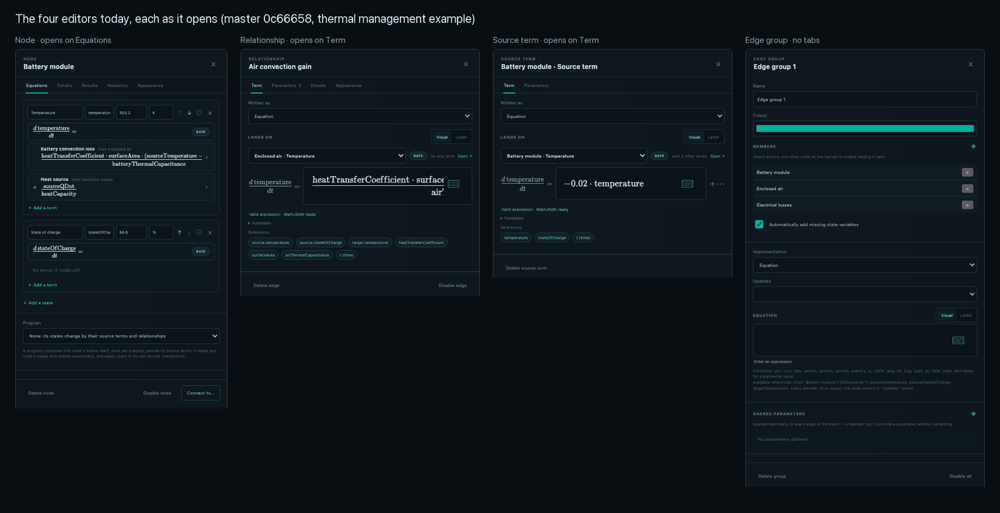
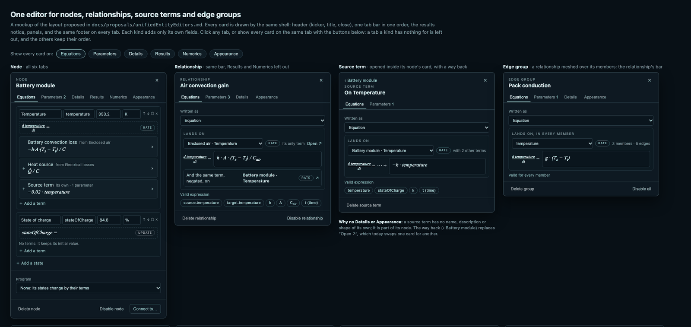

<!-- Copyright © 2026 Zenin Easa Panthakkalakath -->

# One editor for nodes, relationships, source terms and edge groups

**Status: proposed, 21 November 2026. Nothing here is built. It follows [Rates and updates](ratesAndUpdates.md), whose step 5 left "one editor written once for both kinds of term rather than two sharing their parts" still to come.**

## The problem

A node, a relationship, a source term and an edge group are each edited in a card of their own (`#nodeEditor`, `#edgeEditor`, `#sourceTermEditor`, `#edgeGroupEditor` in `src/renderer/index.html`). They look alike because they share CSS (`contextCard editorCard`), and nothing else: each has its own tab markup, its own tab function (`selectNodeEditorTab`, `selectEdgeEditorTab`, `selectTermEditorTab`, none for the group), and its own open function that repeats the same seven steps (hide the other cards, render, choose a tab, clear the position, show, apply the results lock, keep clear of the assistant). Git history shows they never shared a base.



What a person meets, from left to right above:

- **Four tab bars, four orders.** A node has Equations · Details · Results · Numerics · Appearance; a relationship Term · Parameters · Details · Appearance; a source term Term · Parameters; an edge group no tabs at all. The same thing has two names (a node's Equations, a relationship's Term), and a node has no Parameters tab although its terms have parameters.
- **The footer comes and goes.** A node's Delete, Disable and Connect to… show on two of its five tabs (Equations and Details); a relationship's show on all four.
- **Two widths.** A node's card is 390 px wide; the other three are 440 px, so the relationship's equation field cuts its own equation short, and the card jumps in width when "+ Add a term" swaps the node's card for the term's.
- **One thing, two words.** The header says Relationship, the footer says Delete edge and Disable edge, and the + menu says Edge.
- **The same block written three times.** "Written as", where the term lands, the equation, its diagnostics, its functions and references, and the program section are written once for a source term, once for a relationship and once more, older and different ("Implementation", "Updates"), for an edge group; the builders that create a node and a relationship write their own fourth and fifth copies ("Implementation", "Updates", `source.temperature`).
- **Copies drift, as [Design principles](../designPrinciples.md) warns.** The rule that locks an editor while results are open lists `#nodeEditor`, `#edgeEditor` and `#edgeGroupEditor` by id and not `#sourceTermEditor`, so a source term opened from a warning or the Parameters table during results shows its fields open to typing, and silently drops what is typed; and no editor remembers the tab last used, each resetting in its own way.

## The proposal

### One shell, written once

A module, `src/renderer/entityEditor.mjs`, holds one class, `EntityEditor`, that owns everything a card does regardless of what it edits:

- **The card itself**: header with the kind as kicker and the entity's title, the close button, the tab bar, the results notice, a panel per tab, and the footer, built from the declaration below, so the markup of the shell exists once.
- **Tabs**: switching, the count shown on a tab (Parameters 3), which tabs a given entity has, and remembering the tab last used by each kind (below).
- **Opening and closing**: `open(entity, { tab, reveal })` hides the other cards, renders, picks the tab, places the card, shows it, applies the results lock and keeps clear of the assistant panel; `close()`; `refresh()` after undo, redo or a change elsewhere. A card opened from another (a term from its node) keeps a way back to it.
- **Sending a person to a control**: `reveal(selector)` shows the tab a control is on and focuses it, which today is `revealEditorControl` with one branch per editor.
- **The results lock**: one rule for every card: inputs off, navigation (opening a term, going back, switching tabs) on, the Results tab first. The source term's missing lock goes away because there is no list of ids to forget.
- **Footer actions**: declared per kind, shown on every tab, off while results are open.

Each kind of entity is a declaration of its differences, not a copy:

```js
const relationshipEditor = new EntityEditor({
    kind: 'relationship', kicker: 'Relationship', id: 'edgeEditor',
    title: (edge) => edge.title,
    tabs: [termTab({ several: true, reciprocal: true }), parametersTab(), detailsTab(relationshipDetails), appearanceTab(relationshipAppearance)],
    actions: [deleteAction('Delete relationship'), disableAction('relationship')]
});
```

The cards keep their ids (`#nodeEditor`, `#edgeEditor`, `#sourceTermEditor`, `#edgeGroupEditor`) and their fields theirs (`#editNodeName`, `#termMathField`), so the tutorials and the interaction tests that address them keep working; what changes is one attribute for tabs and panels (`data-editor-tab`, `data-editor-panel`) in place of `data-node-tab`, `data-edge-tab` and `data-term-tab`, used today in 16 places in the interaction tests, 6 in the tutorials and 36 in the renderer.

### One order of tabs

Every card uses the same tabs in the same order, and leaves out a tab it has nothing for:

| Tab | Node | Relationship | Source term | Edge group |
| --- | --- | --- | --- | --- |
| **Equations** | its states, each with its equation and the terms reaching it; its program | its term: written as, lands on, the equation or equations | its term: written as, lands on, the equation | its term, landing on a state every member has |
| **Parameters** | every parameter its terms and program read, grouped by where it is written | its parameters | its parameters | the parameters shared by the mesh |
| **Details** | name, type, subsystem, description | name, description, its two ends, direction | — | name, members, adding missing states |
| **Results** | its states over the run | — | — | — |
| **Numerics** | substeps, integration, updates and their limit | — | — | — |
| **Appearance** | colour, shape, rotation, scale, body parts | colour | — | colour |
| Footer | Delete node · Disable node · Connect to… | Delete relationship · Disable relationship | Delete source term | Delete group · Disable all |

A node's card and a relationship's are then the same up to Details, and differ only by what a relationship does not have: it has no states of its own to plot (Results), and it runs at its two ends' steps, so it has no step of its own (Numerics). A source term has no name, description or shape: it is part of its node, so it has only Equations and Parameters. "Term" becomes "Equations" on every card, the word a person uses for what they write there.



### Where every field goes

Nothing is removed; a few things move or are renamed.

| Today | Proposed |
| --- | --- |
| Node · Equations: each state's name, symbol, initial value, unit, ↑ ↓, ◎ fitting target, × | Equations, unchanged |
| Node · Equations: each state's left-hand side and its kind chooser, the terms reaching it, "+ Add a term", "+ Add a state", "Terms reaching no state" | Equations, unchanged |
| Node · Equations: Program (kind, source, code editor, template, FMU, inputs, outputs) | Equations, unchanged (a program's outputs are terms on its states' cards) |
| Node · (none) | **Parameters, new**: its source terms' parameters, each group opening its term, and the shared parameters its program reads, linking to the Parameters table |
| Node · Details: Name, Type, Subsystem, Description | Details, unchanged |
| Node · Results, Numerics (substeps, integration, Updates, sweeps), Appearance (colour, shape, import, shape library, rotation, scale, body parts, units) | unchanged |
| Node footer: Delete node, Disable node, Connect to… (on two tabs) | the same, on every tab |
| Relationship · Term: Written as, Lands on (state, kind badge, terms beside it, Open ↗), the equation with its left-hand side, the other end negated, several equations, diagnostics, functions, references, program | **Equations** (renamed), unchanged inside |
| Relationship · Parameters, Details (Name, Description, Source, Target, Directionality), Appearance (Colour) | unchanged; Source and Target labelled From and To |
| Relationship footer: Delete edge, Disable edge | Delete relationship, Disable relationship |
| Source term · Term: Written as, Lands on, the equation, diagnostics, functions, references, program | **Equations** (renamed), the same term body as a relationship's |
| Source term · Parameters, footer Delete source term | unchanged |
| Edge group, one page: Name, Colour, Members, Automatically add missing state variables | Name, Members and adding missing states on **Details**; Colour on **Appearance** |
| Edge group: Implementation, Updates, Equation, functions, reference hint, program | **Equations**, the same term body ("Written as", "Lands on, in every member") |
| Edge group: Shared parameters | **Parameters** |
| Edge group footer: Delete group, Disable all | unchanged |

### One term body

Written as, Lands on, the equation line, its diagnostics, its functions, its references and its program are one part, `termBody`, used by a source term, a relationship and an edge group; each passes what differs: which states it can land on (its own node's; either end's; a symbol every member has), whether it can have several equations (a relationship), and whether there is another end negated (a relationship running both ways). The builders' equation sections take the same part, so the words a person learns creating a relationship are the words they see editing it (today's builder still says Implementation, Updates and `target.temperature`).

### A term opens inside its node

"+ Add a term", or a term on a state's card, opens the term in the node's own card with a way back ("‹ Battery module"), instead of swapping the node's card for another one of a different width. The Open ↗ beside "Lands on" becomes that way back when the term was opened from its node, and opens the node otherwise (a relationship's landing, a warning). A relationship opened from a state's card gets the same way back. The shell keeps the way back as a short stack, so the same holds for any card opened from another.

### The tab last used

Each kind remembers the tab last chosen, in this window, for as long as it is open: a person who looks at one relationship's parameters and then clicks another relationship sees its parameters. Three things open a named tab instead, as now: a request that names one (a warning sending a person to a parameter, a tutorial step, "+ Add a term", which opens Equations), Results while results are open, and a tab the entity does not have, which falls back to Equations.

### Rates and Updates in it

- **A state's kind belongs to the state**, so it is chosen where the state is: the left-hand side of its card on the node's Equations tab, which opens both kinds as their equations, as today.
- **A term shows the kind it lands on**: the term body writes the state's left-hand side, $\frac{dx}{dt} =$ for a Rate or $x =$ for an Update, before the equation being edited, with the kind as a badge and the terms beside it counted, as the term editors do today; the badge opens the state's card.
- **A relationship's several equations** each name the state they set and show that state's kind, in the same row form.
- **A node's Updates setting** stays on Numerics, the tab for how a node is worked out, beside substeps and integration.

### Edge groups belong

An edge group is one relationship definition meshed across its members, so it is a relationship's editor whose two ends are a list of members and whose parameters are shared: it takes the relationship's tabs (Equations · Parameters · Details · Appearance) and the same term body, landing on a state every member has. It gains the tabs and the results lock the others have; it loses nothing.

### Entry points

Nothing a person reaches today moves out of reach: a click on a node or a relationship opens its card; right-click keeps Connect from here and the rest; a warning, the Parameters table and a tutorial still send a person to the exact control, on whichever tab it is. The + menu's entries are named for what they make, Node and Relationship, the second the same word as the card it opens.

## Built in steps

1. **The shell**, with the node's and the relationship's cards moved onto it unchanged inside, the results lock written once (which locks the source term too), the footer on every tab and one card width. Interaction tests: every tab of every card opens; the footer is on every tab; while results are open every input of every card is off and navigation is on.
2. **The term body**, shared by the source term, the relationship, the edge group and the two builders. Tests: the same term written in each gives the same equation, landing and diagnostics.
3. **One order of tabs**: Equations in place of Term, the node's Parameters tab, the edge group's tabs. Tests: each kind's tabs in the order above; a parameter reached from a warning, the Parameters table and a tutorial on each kind.
4. **The way back and the tab last used.** Tests: "+ Add a term" opens the term in its node's card and back; a second relationship opens on the tab used for the first.

Each step keeps the cards' ids and fields, so the suite runs at every step, and each step is one commit.

## Open questions

These are choices for the product, not for the code:

1. **A term in its node's card, or beside it?** This proposes inside, with a way back (one card, one width, one place to look). Beside, two cards at once, shows the node's equation while the term is written, at the cost of canvas room.
2. **Should a relationship have Results?** A run records states, not what each relationship contributes. Recording each relationship's term over the run would give a relationship a Results tab like a node's, and the two cards would then differ only by Numerics.
3. **Retire the builders?** "Add node" and "Add edge" are forms of their own that create a node or relationship and then open its editor. Creating a minimal node (one state) or relationship (once its ends are picked) and opening its editor on Equations, one undo removing it, would leave one place to write each thing. This proposal shares the term body with the builders either way.
4. **Relationship or edge?** The cards say Relationship; the + menu, the builder, the footer and edge groups say edge. This proposal uses relationship everywhere a person reads it and keeps "edge group" for now.
5. **Choose a state's kind from a term?** The landing badge could open the kind chooser in the term's card, changing the state it lands on from there, rather than going to the state's card.
6. **Remember the tab per kind or per entity, and across restarts?** This proposes per kind, for the session.
7. **A relationship's ends: Details or Equations?** They decide where its term can land, which is on Equations; they are also what a relationship is, which is Details. This proposal keeps them on Details.
8. **Linked components and kinds.** Content put into a model now says its kinds as the model does, but a linked component's instance is put back as its file has it, so one whose file says no kinds, placed in a model that says them, cannot be made to say them in the model. The engine could read "says its kinds" per component or per node rather than per file, which would remove the case and the conversions.

## Out of scope

The subsystem card (no tabs, one panel) and the builders' own fields beyond the term body, until question 3 is answered; the phone layout, which stacks the same cards and follows them.
